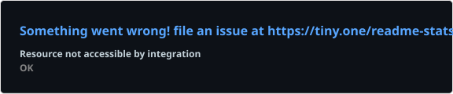

  

  <h1>E aí, eu sou o Gustavo Cortez 👋</h1>
  

    <strong>Tech Lead & Desenvolvedor Full Stack Pleno</strong> • Arquitetura de Software, Microsserviços & Mobile
  

  

    
    
    
    
    
  

---

## 👨‍💻 Sobre mim

- 🎖️ **Tech Lead & Desenvolvedor Full Stack Pleno** na **Exiti Soluções Digitais**, liderando o desenvolvimento de sistemas críticos de monitoramento de barragens, usinas e planos de ação de emergência para grandes players do setor elétrico.
- 🎓 Concluinte de **Sistemas de Informação** na **Universidade Federal de Mato Grosso do Sul (UFMS — CPTL)**.
- 🧑‍🏫 Mais de **350 horas** de atuação acadêmica como monitor de *Algoritmos e Programação I e II* e tutor no projeto de extensão *Conectando Saberes*.
- 🧩 Especialista em **Java (Spring Boot, Quarkus, Payara)**, **TypeScript/JavaScript (React, React Native, Expo, Next.js, Node.js, NestJS)**, **PostgreSQL**, **RabbitMQ**, **Docker** e **Kubernetes**.
- 🚀 Focado atualmente em arquiteturas distribuídas, armazenamento multi-região em nuvem, aplicações mobile *offline-first* e integrações com IA.

> 💡 *"Código limpo, arquitetura escalável e entrega de valor real — do back-end distribuído ao app na mão do usuário."*

---

## 💼 Experiência & Projetos em Destaque

| Projeto / Atuação | Contexto | Stack Principal |
| :--- | :--- | :--- |
| **[Atalayas](https://www.atalayas.com.br/) (Web & Mobile)** | Ecossistema de monitoramento e segurança de barragens na **Exiti**. Um dos responsável pela reconstrução do sistema Web e Mobile completo do Atalayas. | `TypeScript` `React Native` `Expo` `Java` `Spring Boot` |
| **[Fýgora](https://fygora.com.br/) (Web & Mobile)** | Sistema Web e Mobile para gestão de Planos de Ação de Emergência (PAE). O Mobile tem foco em sincronização de dados *offline-first* e atualizações *Over-The-Air* (OTA). Já o Web foi escrito com um banco de dados robusto em Java 25 com Quarkus, com um frontend moderno com React | `React Native` `Expo` `TypeScript` `SQLite` `Java` `Quarkus` |
| **UFMS.O.S.** | Plataforma de Sobrevivência Universitária baseada em microsserviços com assistente inteligente integrado para gestão acadêmica. | `Java` `Spring Boot` `Spring AI` `React` `Vite` `PostgreSQL` |
| **SCEA / CAUAE** | Sistema de Controle de Ética Animal com comunicação assíncrona via mensageria, análise estática de código e testes automatizados E2E. | `Java` `Spring Boot` `RabbitMQ` `React` `PostgreSQL` `Playwright` `SonarQube` |
| **[Anota Chico!](https://anota-chico-landing-page.vercel.app/)** | Assistente de registro de colheita no WhatsApp. | `IA` `ChatBot` `Postgres` |
---

## 🛠️ Tech Stack & Ferramentas

### Back-end & Linguagens

### Front-end & Mobile

### Bancos de Dados & Mensageria

### DevOps, Cloud & Qualidade

### Ferramentas & Design

---

## 📊 Estatísticas no GitHub

  

    <picture data-importer="pacman">
    <source media="(prefers-color-scheme: dark)" srcset="https://raw.githubusercontent.com/gustavo-cortez/gustavo-cortez/pacman-output/bomberman-contribution-graph-dark.svg?game=bomberman">
    <source media="(prefers-color-scheme: light)" srcset="https://raw.githubusercontent.com/gustavo-cortez/gustavo-cortez/pacman-output/bomberman-contribution-graph.svg?game=bomberman">
    
  </picture>
  ###
  

    
    
  

  ###
   
  

---

  
⚡ <strong>Fora do terminal (clique para expandir)</strong>

   
  <ul>
    <li>⚽ Futebol(Palmeiras), Vôlei e Fórmula 1</li>
    <li>🎧 Trilha sonora de deploy: Linkin Park, Twenty One Pilots, Illenium, John Summit, Crankdat, Subtronics e Alleycvt.</li>
    <li>🌾 Otimizando produção de vinho de Ancient Fruit no <em>Stardew Valley</em> nas horas vagas.</li>
    <li>🎮 Ex-Aspirante à ProPlayer de Valorant.</li>
  </ul>

---

  

